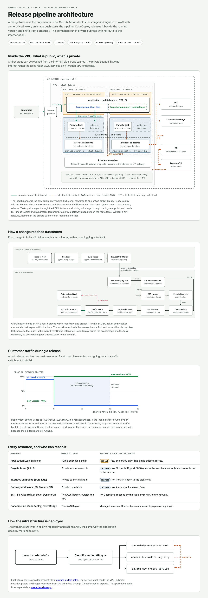

# onward-orders-infra

Infrastructure for the Onward Logistics order system, as AWS CloudFormation.
Everything here is deployed by **CloudFormation GitSync**: a push to `main`
is the deployment. Nothing is created in the console.

The application itself lives in a separate repository, `onward-orders-app`.

## How the pieces fit together

```mermaid
flowchart LR
  subgraph GitHub
    APP[onward-orders-app] --> GHA[GitHub Actions]
    INFRA[onward-orders-infra]
  end

  subgraph AWS
    INFRA -. GitSync .-> CFN[CloudFormation stacks]
    GHA -- "OIDC, no stored keys" --> ECR[(ECR image)]
    GHA -- "taskdef + appspec" --> S3[(S3 release bundle)]
    ECR -- "image pushed" --> EB[EventBridge rule]
    EB --> CP[CodePipeline]
    S3 --> CP
    CP --> CD[CodeDeploy blue/green]

    subgraph VPC
      subgraph Public subnets, 2 zones
        ALB[Application Load Balancer]
      end
      subgraph Private subnets, 2 zones, no internet route
        TASKS[Fargate tasks]
        VPCE[VPC endpoints: ECR, logs, S3]
      end
    end

    CD --> TASKS
    ALB --> TASKS
    TASKS --> VPCE
    TASKS -- "gateway endpoint" --> DDB[(DynamoDB orders table)]
  end

  USERS((Customers)) --> ALB
```

A change to the application travels like this:

1. An engineer merges to `main` in `onward-orders-app`. This is the only manual step.
2. GitHub Actions runs the tests, signs in to AWS with OIDC, pushes the image to ECR and uploads the release bundle to S3.
3. ECR emits an "image pushed" event. An EventBridge rule starts CodePipeline.
4. CodePipeline hands the image and the bundle to CodeDeploy.
5. CodeDeploy starts the new version beside the old one, sends 10% of traffic to it for five minutes, then the rest. The old version stays up for ten more minutes so a rollback is instant.



## What is in this repository

| Path | What it is |
|---|---|
| `templates/network.yaml` | VPC, subnets, security groups, VPC endpoints (ECR, logs, S3, DynamoDB) |
| `templates/registry.yaml` | ECR repository, artifact bucket, the role GitHub Actions assumes |
| `templates/service.yaml` | Load balancer, orders table, ECS service, autoscaling, CodeDeploy, CodePipeline, EventBridge rule |
| `deployments/dev/*.yaml` | One GitSync deployment file per stack: which template, which parameters, which tags |
| `bootstrap/` | The two templates that switch GitSync on. Deployed once from a terminal |
| `docs/discover-report2.docx` | Discovery report (Word): the problem, options considered, the business value and the key design decisions |
| `docs/architecture.png` | Architecture diagram |
| `docs/cost.md` | What the design costs, including private connectivity |

Stacks and what depends on what:

```
onward-dev-orders-connection   (bootstrap)  GitHub connection
onward-dev-orders-gitsync      (bootstrap)  GitSync role and one sync per stack below
onward-dev-orders-network      (GitSync)
onward-dev-orders-registry     (GitSync)
onward-dev-orders-service      (GitSync)    reads outputs of network and registry
```

## Changing something

Edit a template or a deployment file, open a pull request, merge. GitSync
applies the change to the matching stack and reports the result on the commit.

Two things are *not* changed here, because CodeDeploy owns them after the first release:

- **CPU, memory, environment variables of the container**: edit `deploy/taskdef.json` in the application repository. The change is then released with blue/green like any other.
- **Where the listener forwards**: CodeDeploy swaps the two target groups on each release.

To add a `test` or `prod` environment, copy `deployments/dev/` to `deployments/test/`, change `Environment` in each file, and deploy the bootstrap stacks again with `Environment=test`.

## Building from scratch

You need the AWS CLI signed in to the target account, and both repositories pushed to GitHub.

```bash
ENV=dev
OWNER="Jordan Steve"
TAGS="Project=onward Environment=$ENV"
```

**1. Get an approved GitHub connection.** If the account already has one for this GitHub account, reuse it:

```bash
CONNECTION_ARN=$(aws codeconnections list-connections \
  --query "Connections[?ConnectionStatus=='AVAILABLE'].ConnectionArn | [0]" --output text)
```

Otherwise create one with `bootstrap/connection.yaml`, then approve it in the AWS console (*Developer Tools → Settings → Connections → Update pending connection*). GitHub requires a person to approve it once; it cannot be automated. Either way, the GitHub app behind the connection must be allowed to see this repository (GitHub *Settings → Applications → AWS Connector for GitHub → Configure*).

**2. Create the empty stacks for Git sync to take over.** Git sync only updates stacks that already exist.

```bash
for STACK in network registry; do
  aws cloudformation deploy --stack-name onward-$ENV-orders-$STACK \
    --template-file bootstrap/placeholder.yaml --tags $TAGS Owner="$OWNER"
done
```

**3. Switch on Git sync.** Its first sync replaces both placeholders with the real templates.

```bash
aws cloudformation deploy \
  --stack-name onward-$ENV-orders-gitsync \
  --template-file bootstrap/gitsync.yaml \
  --capabilities CAPABILITY_NAMED_IAM \
  --parameter-overrides Environment=$ENV Owner="$OWNER" \
      ConnectionArn=$CONNECTION_ARN \
      GitHubOwner=danjor667 InfraRepositoryName=onward-orders-infra \
      DeployServiceStack=false \
  --tags $TAGS Owner="$OWNER"
```

Wait until `onward-dev-orders-network` and `onward-dev-orders-registry` reach `UPDATE_COMPLETE`. If a sync does not start, push a commit that touches the stack's deployment file.

**4. Push the first image.** In the application repository, set the account ID variable and push to `main` (see its README). Wait for the workflow to finish.

**5. Switch on the service stack.** Create its placeholder, then run the command from step 3 again with `DeployServiceStack=true`. The service starts, and the pipeline runs once by itself as a first blue/green release.

```bash
aws cloudformation deploy --stack-name onward-$ENV-orders-service \
  --template-file bootstrap/placeholder.yaml --tags $TAGS Owner="$OWNER"
```

**6. Open the application.**

```bash
aws cloudformation describe-stacks --stack-name onward-$ENV-orders-service \
  --query "Stacks[0].Outputs[?OutputKey=='ApplicationUrl'].OutputValue" --output text
```

The service stack waits for step 4 because an ECS service cannot start without an image, and the image repository is itself created by Git sync in step 3.

An AWS account can hold only one GitHub OIDC provider. This account already has one, so `deployments/dev/registry.yaml` sets `CreateGitHubOidcProvider: 'false'`; set it to `'true'` in an account that has none.

## Proving the client's checks

| Check | How to show it |
|---|---|
| One public address, private containers | `aws ec2 describe-route-tables --filters Name=tag:Name,Values=onward-dev-orders-private` shows no `0.0.0.0/0` route. The ECS task has no public IP. Only the load balancer security group accepts traffic from outside |
| Push results in a new version | Change the page in the app repository, merge, refresh the URL: the version in the footer changes |
| No downtime | Run `while true; do curl -s -o /dev/null -w "%{http_code}\n" $URL; sleep 1; done` during a release: every line is `200` |
| Bad release reversed | Stop the deployment with rollback in CodeDeploy (`aws deploy stop-deployment --deployment-id ... --auto-rollback-enabled`), or merge a version whose `/health` fails: it never receives traffic |
| No long-lived credentials | The app repository has no secrets, only the variable `AWS_ACCOUNT_ID`. `aws iam list-users` shows no user for the pipeline |
| Scales out and in | Generate load (`hey -z 5m -c 50 $URL`) and watch `aws ecs describe-services --cluster onward-dev-orders --services onward-dev-orders --query "services[0].desiredCount"` |
| Survives a container failure | `aws ecs stop-task` on one task: the page keeps answering and ECS starts a replacement |
| Survives a zone failure | Tasks run in two zones (footer shows the zone). The load balancer stops sending traffic to an unhealthy zone |
| Rebuilt from the repositories | The six steps above |

## Removing everything

Delete in this order, so no stack loses something it still needs:

1. Empty the artifact bucket (all versions) and delete the images in ECR. Deleting the service stack also deletes the orders table and its orders.
2. Delete `onward-dev-orders-service`, then `-registry` and `-network`.
3. Delete `onward-dev-orders-gitsync`, then `-connection`.

Do not push to `main` between steps 2 and 3: GitSync would create the stacks again.
